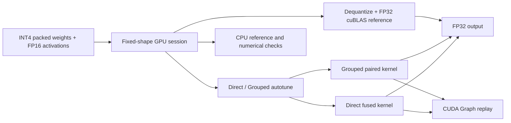

# 技术设计与可解释的优化

## 1. 计算路径

**Direct**：一个CTA计算一个(batch, output channel)，128线程分担K维，相邻线程访问相邻量化值，Warp shuffle求和、共享内存跨Warp归约。并行CTA数量为B×N；B较小时提供更多CTA。

合法 Group 为 16/32/64/128，均为 2 的幂。Direct 在 K≥1024 时使用编译期位移版本计算 Scale 索引，较短 K 保留除法版本；分派在主机完成，K 循环内没有运行时切换。阈值来自本机实验，并非其他设备的性能保证；不同 Shape 的收益、退化和 A/A 波动见 `OPTIMIZATION_20261112.md`。Grouped 保持原实现。

**Grouped**：一个CTA计算相同output channel的全部B个结果；同一量化权重只解包一次并乘以不同B激活，减少权重重复访问。B在编译期分别实例化1、2、4、8以便编译器展开。代价是更多FP32寄存器与更少CTA数量，因此不保证所有形状都更快。

**TwoPassCublas**：单独CUDA核把INT4权重展开为FP32，再把FP16激活转FP32，最后调用cuBLAS SGEMM。该实现只用作公平的**未融合算术参考**，不是cuBLASLt/CUTLASS优选量化库。展开缓冲区按需分配；纯Fused Session不分配展开权重。

## 2. Shape-Aware 自适应选择

每个GpuSession绑定一个固定Shape和GPU设备。首次调用autotune()时，Direct 与 Paired Grouped 交替顺序测量九组，比较每组 CUDA Event 耗时比的中位数；每次采样至少预热10次、重复50次。后续run_auto()复用当前Session选择，不再重复调优。与工业框架的跨Session持久化算法配置缓存不同，这里**只做Session内缓存**。在`bench-all`里随Shape建立新Session，分别调优。

可选内部 trace 保存实际用于选择的九对数据，`--choice-samples` 则记录调优后的独立参考；两者的重复次数和时间窗口可以不同，参考本身也有噪声。单个 Session 的 stream、输出及缓存不支持并发访问，调用者应串行化。

## 3. CUDA Graph

固定Shape、固定设备缓冲区地址的单融合Kernel可以capture成GraphExec；基准测试对Graph执行做单独计时，不与普通Kernel串行计时混成一个数据项。输出仍需和CPU核对。此版本不支持Graph中更改尺寸或者换一组指针，也不支持两步式基线Capture。

## 4. 性能风险与工程边界

- 只有两个CUDA融合候选；未做Tensor Core MMA、向量化4/8位pack load优化、流水双缓冲与高级tiling。
- 量化权重pack为行优先；对于大Batch矩阵计算，这个布局未必最优。
- Sgemm基线展开到FP32，真实生产框架可能有更好的量化基线，不得将其作为工业最优对比。
- GPU准确性必须覆盖非对齐K、尾组、B=1/2/4/8、极小维度和CUDA Graph。主机CPU测试不能证明Warp同步或CUDA存储访问一定正确。
- 4090/4060都是Ada架构sm_89，默认只编译89。不同硬件要修改CMake CUDA_ARCHITECTURES。
- 真实算子成绩不能在没有GPU执行证据时写进简历。

## 5. FP16/BF16 GEMM 与 Residual+RMSNorm

GEMM使用三种独立路径：单线程逐元素点积、共享内存16×16分块（处理非整除尾块）、cuBLAS FP16/BF16输入FP32输出。当前Tiled并未使用Tensor Core WMMA/MMA，不得宣称Tensor Core加速。

Residual+RMSNorm使用FP16输入，fused核在同一个CTA内部计算norm并写FP32输出；两阶段基线先写入FP32 Residual中间矩阵，再做Norm。统一输出类型以便比较。CUDA Kernel采用Warp Shuffle＋共享内存归约，覆盖cols不是256倍数的场景。

GPU真机在RTX 4060/4090上完成`tests/ops_gpu_test.cpp`和`compute-sanitizer`后，才可宣称GPU模块通过验证。

## 5. FP16/BF16 GEMM 与 Residual+RMSNorm 模块

`src/ops_gpu.cu` 另实现 FP16/BF16 GEMM 的 naive、16×16 Shared Memory Tiled 与 cuBLAS 三种路径；所有路径以 FP32 输出进行数值对照。Tiled版本是教学可分析的 CUDA Core 算子，不使用 Tensor Core MMA，不宣称性能超越 cuBLAS。`GemmInput` 的两个矩阵和输出均为行优先。

Residual+RMSNorm有两条路径：融合版本在单Kernel中完成 FP16 残差加和、FP32 方差统计及归一化；两阶段版本先把Residual写入FP32临时内存，再执行RMSNorm。两条路径都使用256线程与Warp Shuffle，覆盖非32对齐的列数。其性能受显存带宽、行长和Kernel启动开销影响，不能保证融合在每种Shape下都更快。

GPU完整测试包含 `tests/ops_gpu_test.cpp`，CPU对应测试为 `tests/ops_cpu_test.cpp`。两种操作也可用 `decodeforge_ops_cli` 分别运行正确性测试及实际GPU基准。

## v1.0.0-rc1消融设计

- `Grouped`（输出名`grouped_paired`）：每线程读取一个pack字节、一个Scale，依次计算两个相邻列，处理奇数K尾部；对当前支持的偶数group，列对位于同组。
- `GroupedScalar`（输出名`grouped_scalar`）：保存之前每线程每轮一个nibble的实现，作为**同一项目、同一GPU、同一Shape**的直接优化对照，而非工业算子基线。
- `Direct`：每个(B,N)输出独立CTA。自动调优只比较Direct与Paired Grouped。
- Paired/Scalar消融在每个Shape下用7组交替测试顺序，比较每组成对耗时比的中位数；不同编译器、GPU或热状态仍可能造成波动。
- 任何FMA精度变动、Warp规约顺序变动可能影响浮点舍入，必须执行完整GPU输出容差回归和Compute Sanitizer。
